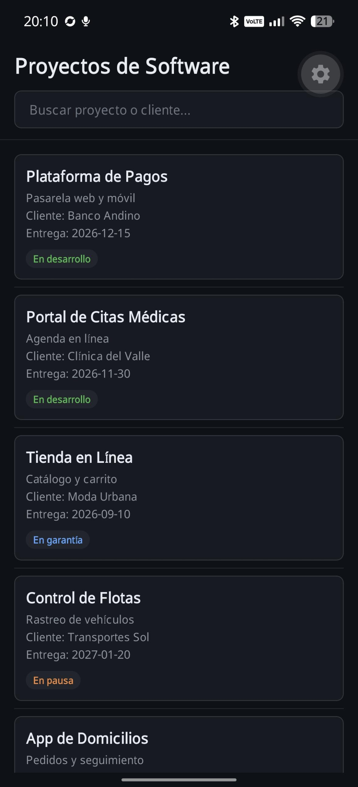

# Semana 2: Listas, Inputs y Estilos

App de la empresa de proyectos de software. Muestra una lista de proyectos con buscador en vivo.

## Dominio

Empresa de proyectos de software. Cada proyecto tiene nombre, descripción corta, cliente, fecha de entrega y estado (en desarrollo, en garantía o en pausa).

## Qué muestra

- Lista de 12 proyectos con `FlatList`.
- Buscador que filtra por nombre o cliente mientras se escribe.
- Mensaje de "Sin resultados" cuando nada coincide.
- Al tocar una tarjeta se muestra el cliente del proyecto.

## Captura



## Cómo ejecutar

```bash
pnpm install
pnpm start
```

Abrir con Expo Go.

## Decisiones de diseño

- **FlatList con `keyExtractor` por `id`:** renderiza solo lo visible y evita problemas de claves.
- **`useMemo` en el filtro:** no recalcula la lista si el texto de búsqueda no cambió.
- **`useCallback` en `renderItem` y `renderEmpty`:** no se crean funciones nuevas en cada render.
- **Tema en `src/theme/index.ts`:** colores, tipografía y espaciado en un solo lugar.
- **Color del badge:** es el único estilo en línea, porque depende del estado de cada proyecto.
- **`KeyboardAvoidingView`:** el teclado no tapa el buscador en iOS.
- **Sin imágenes:** esta semana el foco es la lista y la búsqueda.

## Estructura

```
week-02/
├── App.tsx
├── src/
│   ├── components/ItemCard.tsx
│   ├── data/mockData.ts
│   ├── screens/HomeScreen.tsx
│   ├── theme/index.ts
│   └── types/index.ts
└── docs/screenshot.png
```