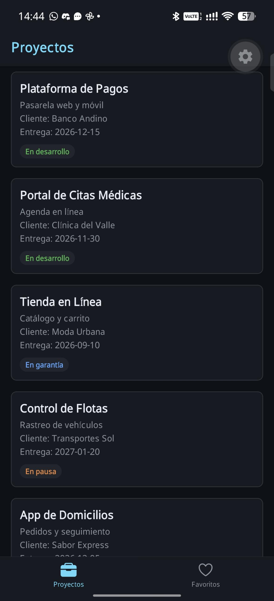
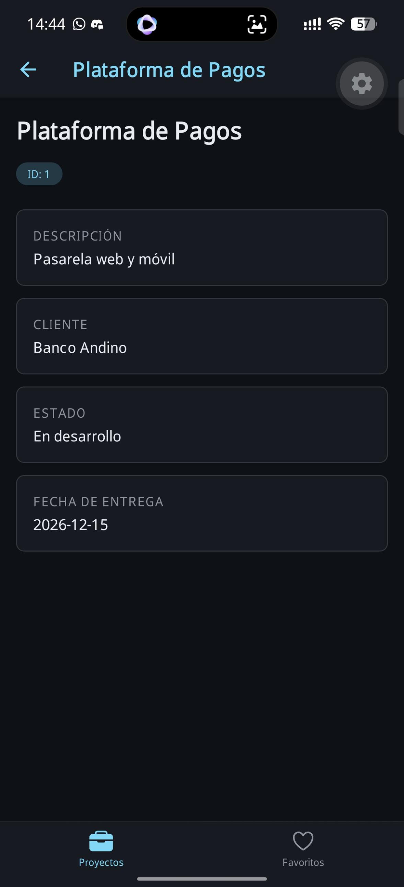

# Semana 3: Navegación con Tab y Stack

App de la empresa de proyectos de software. Tiene dos pestañas: la lista de proyectos con detalle y los favoritos.

## Dominio

Empresa de proyectos de software. Cada proyecto tiene nombre, descripción corta, cliente, fecha de entrega y estado (en desarrollo, en garantía o en pausa).

## Qué muestra

- Pestañas inferiores: Proyectos y Favoritos, con iconos de Ionicons.
- Pestaña Proyectos con un Stack: lista -> detalle.
- Al tocar una tarjeta se abre el detalle con descripción, cliente, estado y fecha de entrega.
- El título del detalle es el nombre del proyecto.
- Pestaña Favoritos con 3 proyectos. Tocar una tarjeta no hace nada todavía.
- Mensaje "No tienes favoritos todavía" si la lista está vacía.

## Capturas




## Cómo ejecutar

```bash
pnpm install
pnpm start
```

Abrir con Expo Go.


## Decisiones de diseño

- **Tab raíz con Stack dentro de Proyectos:** la barra de pestañas siempre se ve y el detalle se apila sobre la lista sin perderla.
- **Favoritos sin Stack:** esa pestaña solo tiene una pantalla, así que usa su propio header.
- **Params tipados en `src/navigation/types.ts`:** `RootTabParamList` y `HomeStackParamList` definen qué recibe cada pantalla.
- **`HomeDetail` recibe el `Project` completo:** el detalle no busca nada, lee todo de `route.params`.
- **`useNavigation` y `useRoute` con tipos:** `NativeStackNavigationProp` en la lista y `RouteProp` en el detalle, para que `tsc` marque errores.
- **Título del detalle desde los params:** `options` como función que lee `route.params.name`.
- **Iconos con `focused`:** Ionicons rellenos si la pestaña está activa, de contorno si no.
- **Tema en `src/theme/index.ts`:** el header, las pestañas y las pantallas usan los mismos colores (acento #61DAFB).
- **Sin favoritos dinámicos:** `FAVORITES` es una lista fija en `mockData.ts`. Agregar y quitar queda para otra semana.

## Estructura

```
week-03/
├── App.tsx
├── src/
│   ├── components/ItemCard.tsx
│   ├── data/mockData.ts
│   ├── navigation/
│   │   ├── RootNavigator.tsx
│   │   └── types.ts
│   ├── screens/
│   │   ├── DetailScreen.tsx
│   │   ├── FavoritesScreen.tsx
│   │   └── HomeScreen.tsx
│   ├── theme/index.ts
│   └── types/index.ts
└── docs/
    ├── screenshot-list.png
    └── screenshot-detail.png
```