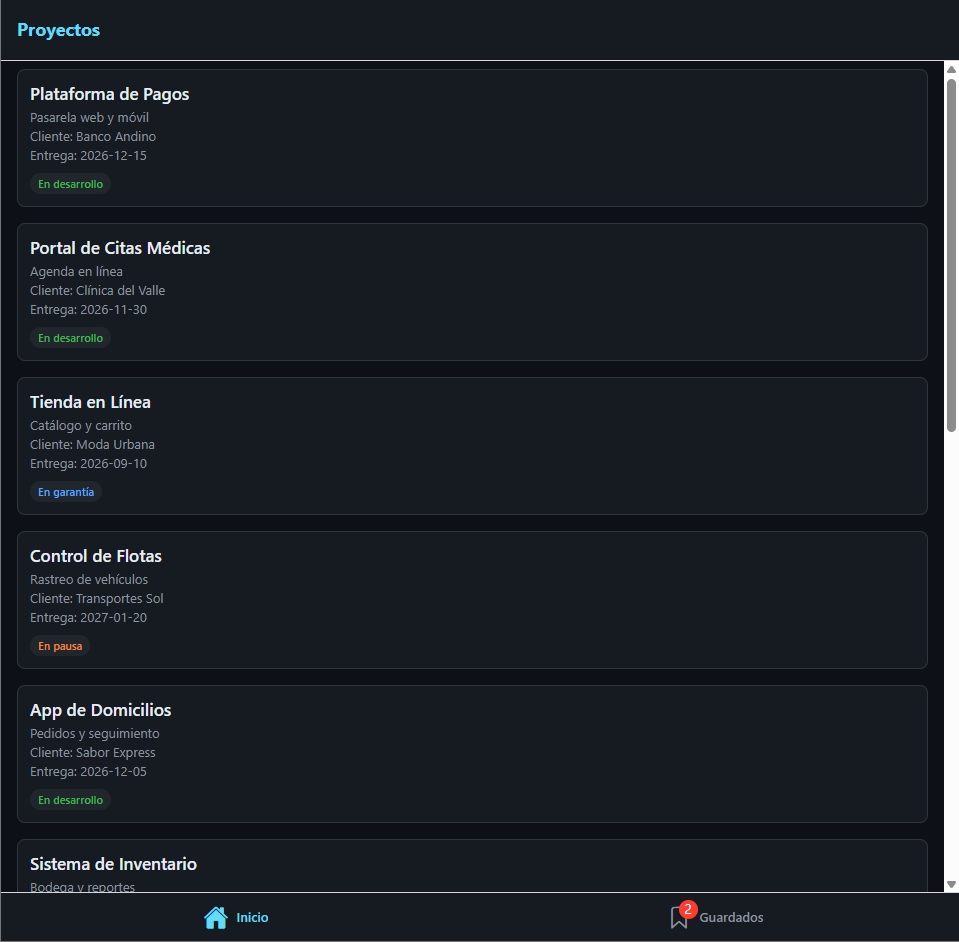
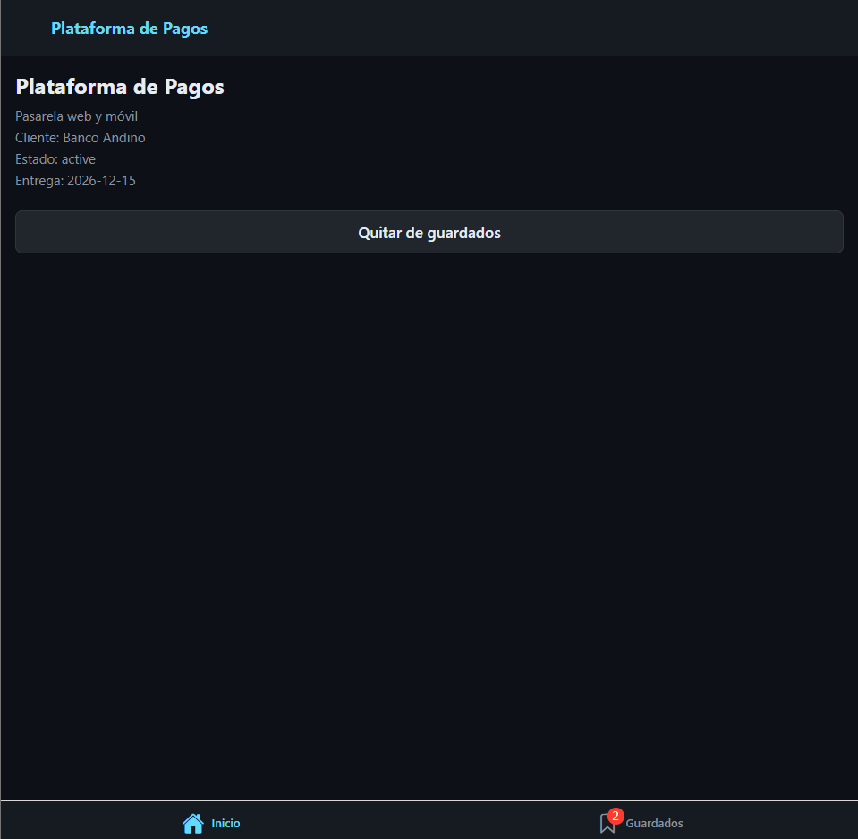
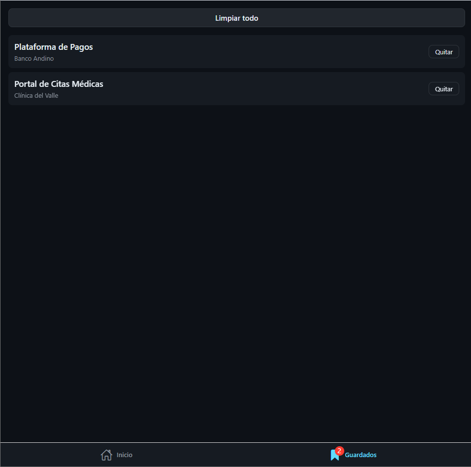

# Semana 4 · Estado global con Zustand

App de **proyectos de software** hecha con Expo y React Native. Lista los proyectos de una empresa, permite guardarlos y muestra los guardados en otra pestaña con un contador (badge) en tiempo real.

## Qué hace la app

- **Inicio:** lista de 12 proyectos con cliente, fecha de entrega y estado (en desarrollo, en garantía o en pausa).
- **Detalle:** al tocar un proyecto se abre su detalle con el botón **Guardar proyecto / Quitar de guardados**.
- **Guardados:** lista de los proyectos guardados, con botón **Quitar** en cada fila y botón **Limpiar todo**.
- **Badge:** la pestaña Guardados muestra cuántos proyectos hay guardados y se actualiza sola.

## Capturas

| Inicio | Detalle | Guardados |
| --- | --- | --- |
|  |  |  |

## Estructura

```
week-04/
├── App.tsx                  # NavigationContainer + SafeAreaProvider
├── index.js                 # registerRootComponent
└── src/
    ├── types/               # Project y ProjectStatus
    ├── data/mockData.ts     # los 12 proyectos
    ├── theme/               # colores, espaciado, tipografía
    ├── components/ItemCard.tsx
    ├── screens/             # HomeScreen, DetailScreen, SavedScreen
    ├── navigation/          # RootNavigator (tabs + stack) y tipos
    └── stores/savedStore.ts # store de Zustand
```

## Decisión: el store de Zustand

Los proyectos guardados viven en **un solo lugar**, `useSavedStore`, y no se pasan por props entre pantallas.

- `items` guarda la lista de proyectos guardados.
- `addItem` no permite duplicados y crea un array nuevo (`[...items, item]`) para que Zustand detecte el cambio.
- `removeItem` usa `filter`; `clearAll` deja la lista vacía.
- Cada componente usa un **selector específico**: el badge lee solo `items.length`, y el detalle calcula si el proyecto está guardado con `items.some(...)`. Así solo se redibuja lo que cambió.
- No se usó `isItemSaved` como selector en las pantallas, porque es una función cuya referencia no cambia y el botón no se actualizaría.

## Navegación

- Tab Navigator con `Home` y `Saved` (Guardados).
- Stack anidado dentro de Home: `HomeList` → `HomeDetail`, con params tipados (`id` y `name`).
- Todo tipado con TypeScript, sin `any`.

## Cómo correrla

```
pnpm install
pnpm start --web
```

El proyecto usa **Expo SDK 57**. La versión actual de Expo Go en el celular es SDK 58 y no abre este proyecto, por eso se probó en el navegador con `react-native-web`.

Verificar tipos:

```
pnpm exec tsc --noEmit
```

## Nota

Los guardados viven en memoria: al recargar la app se pierden. Guardarlos de forma permanente es tema de una semana posterior.