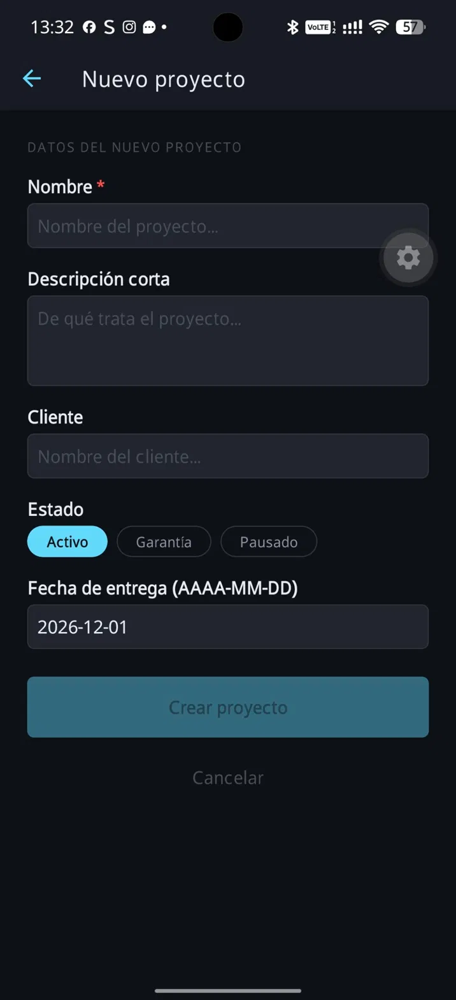
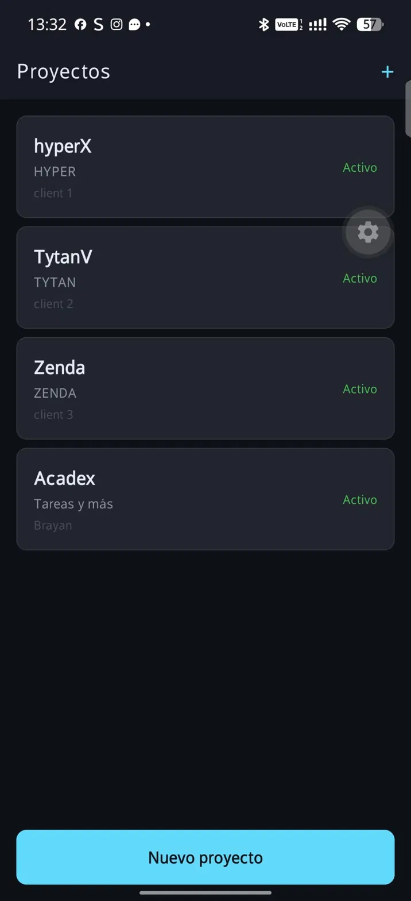

# Semana 5 · Consumo de APIs con TanStack Query

App de **proyectos de software** hecha con Expo y React Native. Lee, muestra y crea proyectos desde una API propia en **mockapi.io**, con estados de carga, error y lista vacía.

## Qué hace la app

- **Inicio:** lista de proyectos que vienen de la API, con cliente y estado (activo, garantía o pausado).
- **Estados:** muestra "Cargando...", un mensaje de error con botón **Reintentar**, o "No hay proyectos todavía" si la lista está vacía.
- **Actualizar:** se puede deslizar hacia abajo para volver a pedir la lista.
- **Detalle:** al tocar un proyecto se abre su detalle.
- **Nuevo proyecto:** pantalla para crear un proyecto; al guardarlo, la lista se actualiza sola.

## Capturas

| Inicio | Detalle | Nuevo proyecto |
| --- | --- | --- |
|  |  |  |

## Estructura
week-05/
├── App.tsx
├── index.js
└── src/
├── types/ # Project, ProjectStatus y CreateProjectPayload
├── services/api.ts # cliente axios con la URL de mockapi
├── hooks/useItems.ts # hooks de TanStack Query
├── screens/ # HomeScreen, DetailScreen, CreateScreen
├── navigation/ # RootNavigator y tipos
└── theme/ # colores, espaciado, tipografía

## Decisiones

**API en mockapi.io.** El recurso `projects` tiene los mismos campos del tipo `Project`: `name`, `subtitle`, `client`, `status` y `deliveryDate`. El `id` lo asigna el servidor.

**Cliente axios único.** Todas las peticiones salen de `apiClient` en `src/services/api.ts`. La URL base está en un solo lugar y se puede cambiar con la variable `EXPO_PUBLIC_API_URL`.

**Hooks con TanStack Query.** Las pantallas no llaman a la API directamente, usan hooks:

- `useItems` pide la lista.
- `useItemById` pide un proyecto.
- `useCreateItem` crea un proyecto con POST. Recibe `CreateProjectPayload`, o sea un proyecto sin `id`, porque el `id` lo pone el servidor.
- `useDeleteItem` borra un proyecto.

**Caché.** Después de crear un proyecto se usa `invalidateQueries` sobre la llave `['projects']`. Así los datos guardados quedan vencidos y la lista se vuelve a pedir sola.

**Tipos.** Todo está tipado con TypeScript, sin `any`.

## Cómo correrla
pnpm install
pnpm start

Abrir en el celular con **Expo Go**.

Verificar tipos:
pnpm exec tsc --noEmit